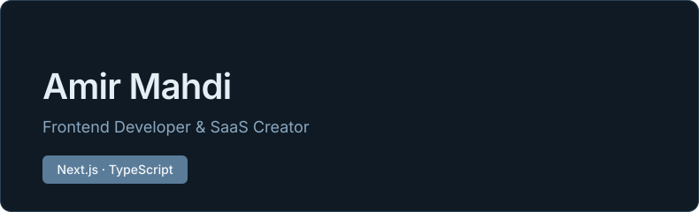

<h3 align="center" style="color:#5B7C99;">Tech Stack</h3>

<table align="center">
<tr>
<td align="center" width="110"> <b>Node.js</b></td>
<td align="center" width="110"> <b>Tailwind</b></td>
<td align="center" width="110"> <b>React</b></td>
<td align="center" width="110"> <b>Next.js</b></td>
</tr>
<tr>
<td align="center" width="110"> <b>TypeScript</b></td>
<td align="center" width="110"> <b>JavaScript</b></td>
<td align="center" width="110"> <b>Git</b></td>
<td align="center" width="110"> <b>PostgreSQL</b></td>
</tr>
<tr>
<td align="center" width="110"> <b>Linux</b></td>
</tr>
</table>

<h3 align="center" style="color:#5B7C99;">Projects</h3>

<table align="center">
<tr>
<td align="left" width="250" valign="top">
<h4>🛒 manMarket</h4>
E-commerce storefront built with <b>Next.js</b> and <b>Tailwind CSS</b>, focused on a polished, high-end user interface.
  

</td>
<td align="left" width="250" valign="top">
<h4>📊 RadcoCRM</h4>
A 0-to-100 Iranian CRM product. Backend in <b>Django REST Framework</b>, frontend in <b>Next.js</b> and <b>TypeScript</b>.
  

</td>
<td align="left" width="250" valign="top">
<h4>🏢 Radcosys</h4>
Company full-stack product built with <b>Next.js</b> on top of a <b>PostgreSQL</b> database.
  

</td>
</tr>
</table>

<h3 align="center" style="color:#5B7C99;">Contact</h3>

Telegram: <a href="https://t.me/Amirixam"><b>@Amirixam</b></a>

